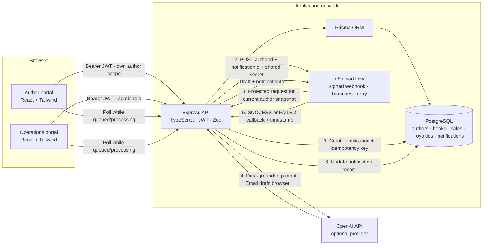
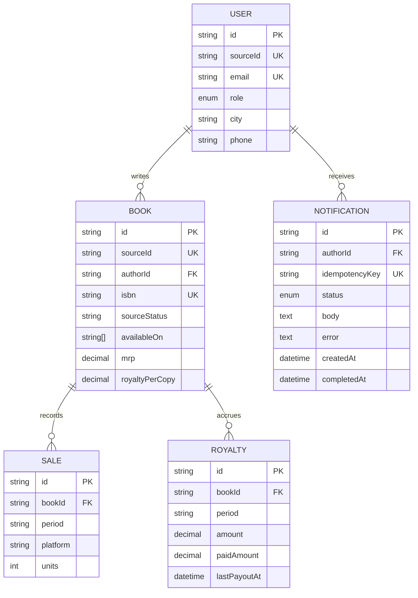
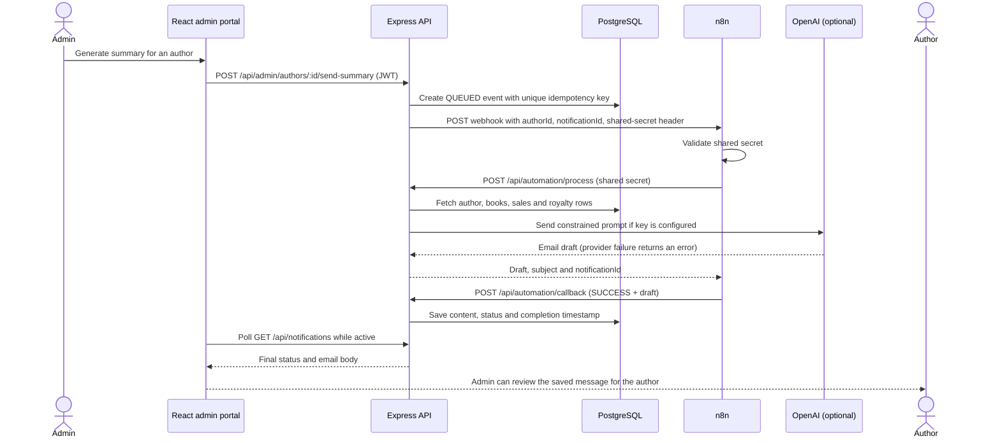
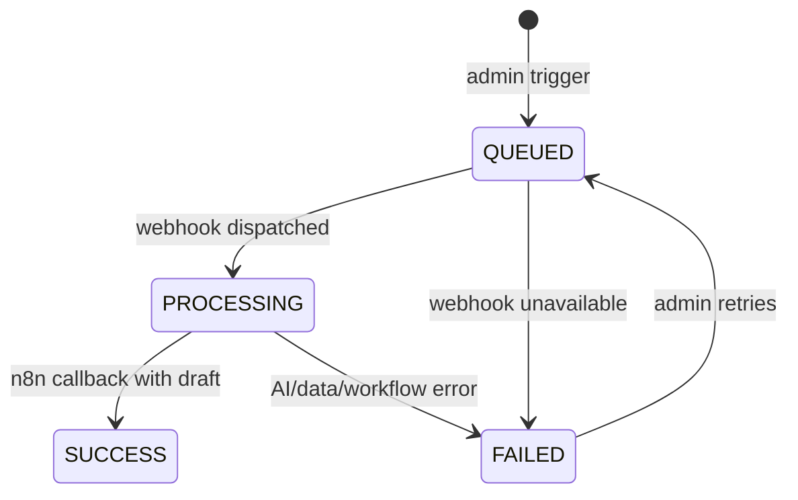

# BookLeaf Royalty Desk — System Design

## 1. Component architecture

## 2. Responsibilities and trust boundaries

| Component    | Owns                                                                                         | Trust boundary                                                                                |
| ------------ | -------------------------------------------------------------------------------------------- | --------------------------------------------------------------------------------------------- |
| React client | Presentation, form state, admin filters, status refresh                                      | Never decides access; no database, AI, JWT signing, or webhook secrets in the bundle          |
| Express API  | Authentication, role checks, validation, royalty calculations, summary prompt, notifications | Verifies signed JWT for app routes; independently verifies shared secret on automation routes |
| Prisma       | Typed relational queries and writes                                                          | All user-supplied IDs are resolved through scoped API logic                                   |
| PostgreSQL   | Source of truth for imported records, balances and notification lifecycle                    | Private Compose network and named persistent volume                                           |
| n8n          | Orchestration, webhook validation, retries, success/failure branches and callback            | Header secret is checked before processing; API checks the same secret again                  |
| AI provider  | Generates prose from a prepared fact set                                                     | Server-side key; output is stored for review and must not alter facts or policy               |

## 3. Data model and import mapping

`server/prisma/data/bookleaf_sample_data.json` is the exact Assignment 1 fixture. The seed maps its stable author/book IDs, names, emails, cities, phone, join date, ISBN, source status, publication date, MRP, royalty per copy, print partner and distribution platforms. Since the fixture reports total sales/royalties rather than channel or quarter breakdowns, the import creates a single clearly labelled `SOURCE_AGGREGATE` sales/royalty row per published book. It does not invent a channel split or earlier payout dates. That means `royalty_paid` plus `last_royalty_payout_date` can be shown as the source's aggregate paid summary; the fixture cannot substantiate a transaction-by-transaction historical ledger.

## 4. Royalty summary sequence

When `OPENAI_API_KEY` is not configured, the service produces a transparent deterministic draft from the same database facts so the local demo remains usable. When a configured provider fails or returns an empty response, the API returns an error; n8n's failure branch marks the notification `FAILED` with the error and completion time. SMTP is not configured; the required verifiable output is the stored draft in the notification log.

## 5. Notification state machine

The API returns the existing queued/processing event when the same author is triggered again inside the 30-second deduplication window. `idempotencyKey` has a database unique constraint as a second guard. Bulk trigger enumerates authors with an outstanding balance and uses the same queue and dispatch path as an individual trigger.

## 6. Authorization and failure handling

- Passwords are bcrypt hashes; login is rate-limited and issues a short-lived JWT.
- Author reads are scoped to the user ID from the verified token. Admin routes use a separate role middleware.
- n8n's inbound request and internal API callbacks use a shared secret header. The browser never sees the shared secret or AI key.
- Zod validates login and automation payloads; Express has a final error handler and request-size limit.
- AI provider errors, invalid callbacks, webhook HTTP errors and API/database errors remain visible as failed operations rather than a spinning UI. The UI refreshes the log every two seconds only while an event is queued or processing.
- Author-facing royalty status is green when paid, yellow while within the payout cycle, and red after 90 days with a pending balance. A published book with no payout uses publication age for the 90-day check; production titles are not flagged as overdue.

## 7. Runtime and delivery

Docker Compose runs PostgreSQL, API, web and n8n 2.46.4. The API waits for database health, applies the checked-in Prisma migration, and seeds the fixture. A named Postgres volume keeps data between restarts. The npm workspace monorepo is orchestrated by Turborepo: `turbo.json` defines the build dependency graph, cached build outputs, and uncached persistent dev/database tasks. CI generates Prisma Client and runs `turbo run build`. The main-branch publish workflow builds separate API and web images to GHCR; configure the repository variable `VITE_API_URL` to the deployed API base URL before publishing the web image.

## 8. Assignment coverage checklist

| Requirement                                              | Implementation                                                                                                     |
| -------------------------------------------------------- | ------------------------------------------------------------------------------------------------------------------ |
| Separated author/book/sales/royalty data, linked records | Prisma schema + PostgreSQL foreign keys and indexes                                                                |
| Same Assignment 1 dataset (10 authors, 18 books)         | Bundled source JSON + idempotent Prisma seed                                                                       |
| Author email/password login and privacy                  | bcrypt/JWT; author scope enforced in API                                                                           |
| My Books fields, royalty totals, badges                  | Author dashboard and expandable book rows                                                                          |
| Admin directory, city/status filters, name search        | Admin portal and `/admin/authors` filter support                                                                   |
| Author detail, individual and bulk trigger               | Admin directory actions; shared queue/dispatch path                                                                |
| Notification log and visible generated output            | `/api/notifications`, detail modal and completion polling                                                          |
| Secured n8n flow, data fetch, AI prompt, callback        | Workflow export and shared-secret endpoints                                                                        |
| AI/provider/webhook failures and duplicate clicks        | Failure callback, error display and 30-second dedupe                                                               |
| README/system design, Docker, CI/CD                      | Project README, this architecture, Compose and GitHub workflows                                                    |
| Historical payment transactions                          | Source fixture only provides aggregate paid total and last payout date; no per-transaction records exist to import |

## 9. External submission items

The PDF requests a Bubble editor app and a 3–5 minute walkthrough recording. The direct user request chose the full code stack instead, so this repository implements the same product requirements in React/Express/Prisma and does not create a Bubble app or editor share URL. No public deployment or recording file is included; the README gives a walkthrough for recording the running app. The n8n workflow JSON is included, but importing/publishing it and granting workspace access require the user's n8n instance.
